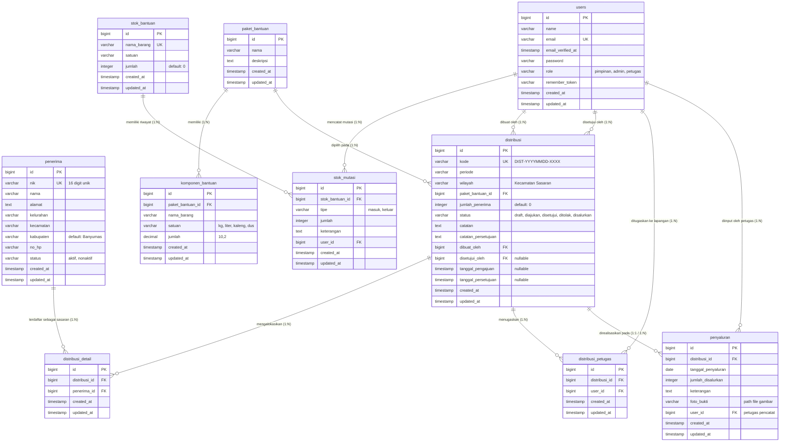

# SKEMA BASIS DATA RESMI & PANDUAN PENGEMBANGAN PENAMAS
**Sistem Informasi Pengelolaan Bantuan Pangan Masyarakat Kabupaten Banyumas**
*Mendukung SDG 2: Tanpa Kelaparan (Zero Hunger) — Dinsospermades Kab. Banyumas*

---

Dokumen ini disusun sebagai acuan utama (*single source of truth*) struktur basis data bagi seluruh pengembang Kelompok 2 (Kelas REG 01) agar pembagian tugas fitur dan PBI berjalan selaras tanpa konflik dependensi.

---

## 1. Entity Relationship Diagram (ERD)

---

## 2. Pemetaan Fitur & PBI Terhadap Tabel Basis Data

Berikut pembagian tanggung jawab tabel untuk masing-masing pengembang sesuai matriks Sprint 1 & Sprint 2:

| No | Pengembang (PIC) | Sprint 1 (Fitur & PBI) | Sprint 2 (Fitur & PBI) | Tabel Basis Data yang Digunakan |
|---|---|---|---|---|
| 1 | **Riyan Saefuloh** | **F-01: Kelola Akun Pengguna** • PBI-001 (Register & Role) • PBI-002 (Ubah Data & Hak Akses) • PBI-003 (Hapus Akun) | **F-08: Pengajuan & Persetujuan Distribusi** • PBI-022 (Pengajuan Draf) • PBI-023 (Approve/Reject + Catatan) • PBI-024 (Revisi & Ajukan Ulang) | • `users` • `distribusi` (`status`, `catatan_persetujuan`, `dibuat_oleh`, `disetujui_oleh`, `tanggal_pengajuan`, `tanggal_persetujuan`) |
| 2 | **Nayaka Shafwan Bagas Adi Prasetyo** | **F-02: Kelola Data Penerima Bantuan** • PBI-004 (Tambah KPM & NIK 16 digit) • PBI-005 (Ubah Alamat & Status) • PBI-006 (Filter NIK/Nama & Kecamatan) | **F-09: Pencatatan Penyaluran & Foto Bukti** • PBI-025 (Lihat Penugasan Petugas Sendiri) • PBI-026 (Catat Realisasi Serah Terima) • PBI-027 (Upload Berkas Foto Bukti) | • `penerima` • `penyaluran` (`tanggal_penyaluran`, `jumlah_disalurkan`, `foto_bukti`, `keterangan`) • `distribusi_petugas` (Otorisasi tugas petugas) |
| 3 | **Isaf Khiyar Musyaffa** | **F-03: Kelola Paket Bantuan** • PBI-007 (Buat Paket & Komponen) • PBI-008 (Ubah Komponen Barang) • PBI-009 (Hapus Paket Terproteksi) | **F-10: Sinkronisasi Otomatis Stok** • PBI-028 (Kalkulasi Kebutuhan Komoditas) • PBI-029 (Auto-decrement Stok Gudang) • PBI-030 (Auto-insert Mutasi Keluar) | • `paket_bantuan` • `komponen_bantuan` • `stok_bantuan` • `stok_mutasi` • `penyaluran` (Database Transaction) |
| 4 | **Aghna Mumtaz Ilmi** | **F-04: Kelola Stok Barang di Gudang** • PBI-010 (Catat Komoditas Baru) • PBI-011 (Monitoring Saldo Sisa Stok) • PBI-012 (Hapus Item Komoditas) | **F-07: Buat Rencana Pembagian Bantuan** • PBI-019 (Form Draf Distribusi & Kode Unik) • PBI-020 (Pilih Checkbox Warga Sasaran) • PBI-021 (Pilih Petugas Lapangan) | • `stok_bantuan` • `distribusi` • `distribusi_detail` (Pivot Sasaran KPM) • `distribusi_petugas` (Pivot Petugas) |
| 5 | **Edwin Salman Hakim** | **F-05: Halaman Ringkasan (Dashboard)** • PBI-013 (Kartu KPI Statistik Master Data) • PBI-014 (Badge Antrean Persetujuan Diajukan) • PBI-015 (Tabel Ringkas 5 Aktivitas Terbaru) | **F-11: Laporan Bantuan Pangan** • PBI-031 (Rekap Penerima per Kecamatan) • PBI-032 (Laporan Posisi Saldo Stok Gudang) • PBI-033 (Laporan Distribusi Filter Tanggal) | • Query Agregasi: `penerima`, `paket_bantuan`, `stok_bantuan`, `distribusi`, `penyaluran` |
| 6 | **Helmi Arif Zulfikar** | **F-06: Catatan Keluar-Masuk Stok Gudang** • PBI-016 (Mutasi Masuk Pengadaan/Donatur) • PBI-017 (Mutasi Keluar Manual Barang Rusak) • PBI-018 (Riwayat & Log Audit Mutasi) | **F-12: Pemantauan Status & Detail Penyaluran** • PBI-034 (Badge Status & Filter Lifecycle) • PBI-035 (Detail Rencana, Tim, & Sasaran) • PBI-036 (Galeri Foto Dokumentasi Lapangan) | • `stok_mutasi` • `stok_bantuan` • `distribusi` • `penyaluran` (Tampilan Galeri Bukti Foto) |

---

## 3. Kamus Data (Data Dictionary) Terinci

### 3.1 Tabel `users`
Menyimpan akun pengguna sistem dengan pembagian 3 tingkatan hak akses (Role-Based Access Control).

| Kolom | Tipe Data | Nullable | Default | Keterangan & Aturan |
|---|---|---|---|---|
| `id` | BIGINT UNSIGNED | No | Auto Increment | Primary Key |
| `name` | VARCHAR(255) | No | - | Nama lengkap petugas/pimpinan |
| `email` | VARCHAR(255) | No | - | Email unik untuk autentikasi sistem |
| `email_verified_at` | TIMESTAMP | Yes | NULL | Verifikasi email (opsional) |
| `password` | VARCHAR(255) | No | - | Hash bcrypt sandi pengguna |
| `role` | VARCHAR(50) | No | `'petugas'` | Nilai yang diizinkan: `'pimpinan'`, `'admin'`, `'petugas'` |
| `remember_token` | VARCHAR(100) | Yes | NULL | Token sesi login otomatis |
| `created_at` | TIMESTAMP | Yes | NULL | Waktu akun didaftarkan |
| `updated_at` | TIMESTAMP | Yes | NULL | Waktu profil akun diperbarui |

---

### 3.2 Tabel `penerima`
Menyimpan master data Keluarga Penerima Manfaat (KPM) warga Kabupaten Banyumas.

| Kolom | Tipe Data | Nullable | Default | Keterangan & Aturan |
|---|---|---|---|---|
| `id` | BIGINT UNSIGNED | No | Auto Increment | Primary Key |
| `nik` | VARCHAR(16) | No | - | NIK unik KTP 16 digit (Wajib tervalidasi numerik) |
| `nama` | VARCHAR(255) | No | - | Nama lengkap kepala keluarga / penerima |
| `alamat` | TEXT | No | - | Alamat detail (RT, RW, nama jalan) |
| `kelurahan` | VARCHAR(100) | No | - | Desa / Kelurahan |
| `kecamatan` | VARCHAR(100) | No | - | Kecamatan di wilayah Kabupaten Banyumas |
| `kabupaten` | VARCHAR(100) | No | `'Banyumas'` | Wilayah administrasi kabupaten |
| `no_hp` | VARCHAR(20) | Yes | NULL | Kontak nomor telepon / WhatsApp penerima |
| `status` | VARCHAR(20) | No | `'aktif'` | Status kelayakan: `'aktif'` atau `'nonaktif'` |
| `created_at` | TIMESTAMP | Yes | NULL | Tanggal pencatatan data KPM |
| `updated_at` | TIMESTAMP | Yes | NULL | Tanggal pembaruan data KPM |

---

### 3.3 Tabel `paket_bantuan`
Menyimpan definisi paket bantuan pangan yang disediakan dinas.

| Kolom | Tipe Data | Nullable | Default | Keterangan & Aturan |
|---|---|---|---|---|
| `id` | BIGINT UNSIGNED | No | Auto Increment | Primary Key |
| `nama` | VARCHAR(255) | No | - | Nama paket (contoh: *Paket Sembako A*, *Paket Balita*) |
| `deskripsi` | TEXT | Yes | NULL | Catatan isi peruntukan bantuan paket |
| `created_at` | TIMESTAMP | Yes | NULL | Waktu dibuat |
| `updated_at` | TIMESTAMP | Yes | NULL | Waktu diperbarui |

---

### 3.4 Tabel `komponen_bantuan`
Rincian isi item bahan pangan di dalam setiap paket bantuan.

| Kolom | Tipe Data | Nullable | Default | Keterangan & Aturan |
|---|---|---|---|---|
| `id` | BIGINT UNSIGNED | No | Auto Increment | Primary Key |
| `paket_bantuan_id` | BIGINT UNSIGNED | No | - | Foreign Key mengacu ke `paket_bantuan.id` (ON DELETE CASCADE) |
| `nama_barang` | VARCHAR(255) | No | - | Nama komoditas (contoh: Beras, Minyak Goreng, Gula Pasir) |
| `satuan` | VARCHAR(50) | No | - | Satuan komoditas (kg, liter, kaleng, bungkus) |
| `jumlah` | DECIMAL(10,2) | No | - | Kuantitas per paket (contoh: 5.00, 2.00) |
| `created_at` | TIMESTAMP | Yes | NULL | Waktu dibuat |
| `updated_at` | TIMESTAMP | Yes | NULL | Waktu diperbarui |

---

### 3.5 Tabel `stok_bantuan`
Pencatatan persediaan fisik barang bantuan pangan yang tersedia di gudang Dinsospermades.

| Kolom | Tipe Data | Nullable | Default | Keterangan & Aturan |
|---|---|---|---|---|
| `id` | BIGINT UNSIGNED | No | Auto Increment | Primary Key |
| `nama_barang` | VARCHAR(255) | No | - | Nama komoditas bahan pangan |
| `satuan` | VARCHAR(50) | No | - | Satuan takaran stok (kg, liter, kaleng, dus) |
| `jumlah` | INT | No | `0` | Saldo persediaan terkini di gudang |
| `created_at` | TIMESTAMP | Yes | NULL | Waktu registrasi barang |
| `updated_at` | TIMESTAMP | Yes | NULL | Waktu saldo stok berubah |

---

### 3.6 Tabel `stok_mutasi`
Buku besar riwayat pergerakan keluar dan masuk persediaan stok gudang.

| Kolom | Tipe Data | Nullable | Default | Keterangan & Aturan |
|---|---|---|---|---|
| `id` | BIGINT UNSIGNED | No | Auto Increment | Primary Key |
| `stok_bantuan_id` | BIGINT UNSIGNED | No | - | Foreign Key ke `stok_bantuan.id` (ON DELETE CASCADE) |
| `tipe` | VARCHAR(20) | No | - | Jenis pergerakan: `'masuk'` (tambah) atau `'keluar'` (kurang) |
| `jumlah` | INT | No | - | Kuantitas barang yang berpindah (bilangan bulat positif) |
| `keterangan` | TEXT | Yes | NULL | Alasan mutasi (Pengadaan Dinsos, Donasi, Barang Rusak, Penyaluran Otomatis) |
| `user_id` | BIGINT UNSIGNED | No | - | Foreign Key ke `users.id` (Petugas/Admin yang mencatat) |
| `created_at` | TIMESTAMP | Yes | NULL | Waktu pencatatan mutasi |
| `updated_at` | TIMESTAMP | Yes | NULL | Waktu perubahan data |

---

### 3.7 Tabel `distribusi`
Pusat alur transaksi perencanaan, persetujuan bertingkat, dan status distribusi bantuan sosial.

| Kolom | Tipe Data | Nullable | Default | Keterangan & Aturan |
|---|---|---|---|---|
| `id` | BIGINT UNSIGNED | No | Auto Increment | Primary Key |
| `kode` | VARCHAR(50) | No | - | Format otomatis unik: `DIST-YYYYMMDD-XXXX` |
| `periode` | VARCHAR(50) | No | - | Periode pelaksanaan (contoh: "November 2026") |
| `wilayah` | VARCHAR(100) | No | - | Wilayah kecamatan sasaran |
| `paket_bantuan_id` | BIGINT UNSIGNED | No | - | Foreign Key ke `paket_bantuan.id` |
| `jumlah_penerima` | INT | No | `0` | Jumlah warga sasaran yang dialokasikan |
| `status` | VARCHAR(30) | No | `'draft'` | Lifecycle: `'draft'`, `'diajukan'`, `'disetujui'`, `'ditolak'`, `'disalurkan'` |
| `catatan` | TEXT | Yes | NULL | Catatan petunjuk dari Admin saat membuat draf |
| `catatan_persetujuan` | TEXT | Yes | NULL | Catatan evaluasi / alasan penolakan oleh Pimpinan |
| `dibuat_oleh` | BIGINT UNSIGNED | No | - | Foreign Key ke `users.id` (Admin pembuat rencana) |
| `disetujui_oleh` | BIGINT UNSIGNED | Yes | NULL | Foreign Key ke `users.id` (Pimpinan peninjau) |
| `tanggal_pengajuan` | TIMESTAMP | Yes | NULL | Waktu diajukan oleh Admin |
| `tanggal_persetujuan` | TIMESTAMP | Yes | NULL | Waktu keputusan (setuju/tolak) oleh Pimpinan |
| `created_at` | TIMESTAMP | Yes | NULL | Waktu dibuat |
| `updated_at` | TIMESTAMP | Yes | NULL | Waktu status diperbarui |

---

### 3.8 Tabel `distribusi_detail` (Pivot Penerima Sasaran)
Menyimpan daftar warga penerima manfaat (KPM) yang dipilih untuk jadwal distribusi tertentu.

| Kolom | Tipe Data | Nullable | Default | Keterangan & Aturan |
|---|---|---|---|---|
| `id` | BIGINT UNSIGNED | No | Auto Increment | Primary Key |
| `distribusi_id` | BIGINT UNSIGNED | No | - | Foreign Key ke `distribusi.id` (ON DELETE CASCADE) |
| `penerima_id` | BIGINT UNSIGNED | No | - | Foreign Key ke `penerima.id` (ON DELETE CASCADE) |
| `created_at` | TIMESTAMP | Yes | NULL | Waktu dicatat |
| `updated_at` | TIMESTAMP | Yes | NULL | Waktu diperbarui |
| **Constraint** | UNIQUE(`distribusi_id`, `penerima_id`) | - | - | Mencegah penerima ganda dalam satu distribusi yang sama |

---

### 3.9 Tabel `distribusi_petugas` (Pivot Penugasan Lapangan)
Menyimpan daftar petugas (TKSK / staf lapangan) yang diberi mandat menyalurkan paket bantuan.

| Kolom | Tipe Data | Nullable | Default | Keterangan & Aturan |
|---|---|---|---|---|
| `id` | BIGINT UNSIGNED | No | Auto Increment | Primary Key |
| `distribusi_id` | BIGINT UNSIGNED | No | - | Foreign Key ke `distribusi.id` (ON DELETE CASCADE) |
| `user_id` | BIGINT UNSIGNED | No | - | Foreign Key ke `users.id` (Petugas bertugas, ON DELETE CASCADE) |
| `created_at` | TIMESTAMP | Yes | NULL | Waktu penugasan |
| `updated_at` | TIMESTAMP | Yes | NULL | Waktu diperbarui |
| **Constraint** | UNIQUE(`distribusi_id`, `user_id`) | - | - | Mencegah duplikasi nama petugas pada distribusi yang sama |

---

### 3.10 Tabel `penyaluran`
Mencatat bukti fisik serah terima bantuan pangan kepada KPM di titik pembagian.

| Kolom | Tipe Data | Nullable | Default | Keterangan & Aturan |
|---|---|---|---|---|
| `id` | BIGINT UNSIGNED | No | Auto Increment | Primary Key |
| `distribusi_id` | BIGINT UNSIGNED | No | - | Foreign Key ke `distribusi.id` (ON DELETE CASCADE) |
| `tanggal_penyaluran` | DATE | No | - | Tanggal pelaksanaan serah terima fisik |
| `jumlah_disalurkan` | INT | No | - | Jumlah paket bantuan yang telah dibagikan |
| `keterangan` | TEXT | Yes | NULL | Catatan lapangan saat pembagian bantuan |
| `foto_bukti` | VARCHAR(255) | Yes | NULL | Path relatif berkas foto serah terima di storage publik |
| `user_id` | BIGINT UNSIGNED | No | - | Foreign Key ke `users.id` (Petugas yang menyerahkan/menginput) |
| `created_at` | TIMESTAMP | Yes | NULL | Waktu transaksi disimpan |
| `updated_at` | TIMESTAMP | Yes | NULL | Waktu transaksi diubah |

---

## 4. Aturan Bisnis Transaksional & Logika Integritas

1. **Siklus Status Distribusi (*Status Lifecycle*)**:
   $$\text{draft} \xrightarrow{\text{Admin: Ajukan}} \text{diajukan} \xrightarrow{\text{Pimpinan: Setujui}} \text{disetujui} \xrightarrow{\text{Petugas: Catat Serah Terima}} \text{disalurkan}$$
   - Jika Pimpinan memilih **Tolak**, status berubah menjadi $\text{ditolak}$ disertai catatan review wajib (`catatan_persetujuan`).
   - Admin dapat memperbaiki draf dan mengajukan kembali ($\text{ditolak} \xrightarrow{\text{Revisi}} \text{diajukan}$).

2. **Isolasi Akses Petugas Lapangan (PBI-025)**:
   - Pengguna dengan `role = 'petugas'` hanya boleh mengakses data penyaluran apabila `auth()->id()` terdaftar pada tabel relasi `distribusi_petugas` untuk distribusi terkait.

3. **Integritas Sinkronisasi Stok Otomatis (F-10: PBI-028, PBI-029, PBI-030)**:
   - Ketika petugas menyimpan formulir `penyaluran/store`:
     - Dilakukan dalam blok aman `DB::transaction(...)`.
     - Kebutuhan komoditas dihitung dari perkalian: $\text{Kebutuhan} = \text{jumlah\_komponen} \times \text{jumlah\_paket\_disalurkan}$.
     - Saldo `stok_bantuan.jumlah` dipotong secara langsung (`decrement`).
     - Baris mutasi otomatis di-insert ke `stok_mutasi` bertipe `'keluar'` dengan mencantumkan kode distribusi dan identitas petugas.
     - Jika saldo tidak mencukupi atau terjadi kendala I/O, seluruh operasi di-rollback demi menjaga konsistensi data.

